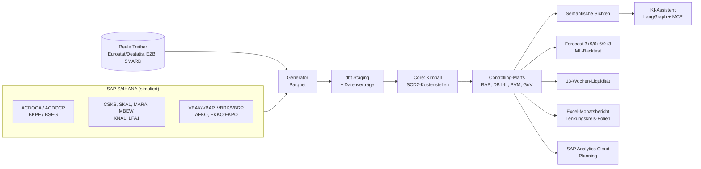

# Fachkonzept Planwerk

**Controlling- und Planungsplattform mit KI-Controlling-Assistent**

| | |
|---|---|
| Version | 1.0 vom 08.11.2026 |
| Bezug | Lastenheft 1.0, ADR-0001 bis ADR-0004 |
| Hinweis | Alle Unternehmensdaten sind **simuliert** (fiktive Nordwerk-Gruppe). Real sind nur die makroökonomischen Treiber. |

Das Fachkonzept beschreibt, *wie* Planwerk die Anforderungen des Lastenhefts umsetzt. Jede
Regel hier ist im Code umgesetzt und durch einen Test abgesichert; die Spalte „Nachweis" nennt
die Stelle.

---

## 1 Architektur



| Schicht | Lokal (Standard) | Zielumgebung |
|---|---|---|
| Quelle | Generator → Parquet (`data/raw`) | S/4HANA → SAP Datasphere / HANA Cloud |
| Warehouse | DuckDB | Snowflake (Terraform, Row Access Policies) |
| Transformation | dbt (dbt-duckdb) | dbt (dbt-snowflake), gleicher Code |
| Planung | Treiberbasierte Planung in Python, Planversionen als Tabellen | SAP Analytics Cloud Planning |
| KI | Offline-Schreiber (deterministisch) | Azure OpenAI / AI Foundry, Teams über Copilot Studio |

## 2 Organisationsstruktur

| Objekt | Ausprägung |
|---|---|
| Kostenrechnungskreis | NW00, Konzernwährung EUR, Geschäftsjahresvariante K4 (= Kalenderjahr) |
| Buchungskreise | 1000 Nordwerk GmbH (DE, EUR), 2000 Nordwerk Austria GmbH (AT, EUR), 3000 Nordwerk Polska Sp. z o.o. (PL, PLN) |
| Kontenplan | NWKR (an SKR04 angelehnt, 6-stellig) |
| Produktgruppen | PG10 Kreiselpumpen, PG20 Dosierpumpen, PG30 Ventile und Armaturen, PG40 Ersatzteile, PG50 Service |
| Kundengruppen | 01 OEM/Anlagenbauer, 02 Industrie, 03 Kommunal/Wasserwirtschaft, 04 Handel |

## 3 Datenmodell

### 3.1 Quelltabellen

Die Spaltennamen folgen den SAP-Feldnamen (z. B. `RBUKRS`, `RACCT`, `RCNTR`, `HSL`, `KSL`,
`MSL`). Beträge sind vorzeichenbehaftet (Soll positiv, Haben negativ), wie in ACDOCA.

| Tabelle | Inhalt | Besonderheit |
|---|---|---|
| ACDOCA | Universal Journal, Ledger 0L | TSL (Transaktions-), HSL (Hauswährung), KSL (Konzernwährung EUR); Ausgleich über AUGBL/AUGDT |
| ACDOCP | Planzeilen, Kategorie PLN | Mengen (MSL) für Erlöse, Planwechselkurs |
| BKPF/BSEG | Belegkopf und FI-Sicht | BSEG als Kompatibilitätssicht auf ACDOCA |
| CSKS | Kostenstellen | Gültigkeitsintervalle DATAB/DATBI → SCD2 |
| VBAK/VBAP | Kundenaufträge | Auftragseingang = Frühindikator (Q2) |
| VBRK/VBRP | Fakturen | Preis zum Auftragsdatum |
| AFKO | Fertigungsaufträge | Kundeneinzelfertigung, Bezug KDAUF/KDPOS |
| EKKO/EKPO | Bestellungen | Monatliche Abrufe je Lieferant |
| PRICE_LIST, DISCOUNT_COND | Preiskonditionen | Versionen ACT (gültig) und PLN (Planannahme) |

### 3.2 Belegfluss

| Vorgang | Belegart | Buchung |
|---|---|---|
| Faktura | RV | Forderung (120000) an Erlöse (400000/405000) und Umsatzsteuer (380000) |
| Warenausgang | WL | Bestandsveränderung (480000) bzw. Handelswarenaufwand (503000) an Fertigerzeugnisse (101000) |
| Verbrauch Fertigungsauftrag | WA | Materialaufwand 500000–502000 (Kostenstelle Fertigung) an Rohstoffe (100000) |
| Fertigmeldung | WE | Fertigerzeugnisse an Bestandsveränderung, zum Standardpreis |
| Wareneingang Bestellung | WE | Rohstoffe/Handelswaren an WE/RE-Verrechnung (350000) |
| Eingangsrechnung | RE / KR | WE/RE bzw. Aufwand + Vorsteuer an Verbindlichkeit (330000) |
| Zahlungen | DZ / KZ | Bank (180000) an Forderung/Verbindlichkeit, mit Skonto (409000) und Kursdifferenz (760000) |
| Lohn und Gehalt | SA | Summenbuchung je Kostenstelle aus der Lohnabrechnung (keine Personendaten) |
| Abschreibung | AF | 680000 an kumulierte Abschreibungen |
| USt-Voranmeldung | UV | am 10. des Folgemonats |

Nachweis: `tests/test_generator.py` (jeder Beleg ausgeglichen in TSL, HSL und KSL;
ausgeglichene Posten heben sich auf; Erlöse im Hauptbuch = Fakturen).

### 3.3 Dimensionales Modell (Kimball)

| Fakt | Körnung |
|---|---|
| `fct_journal_line` | Belegzeile, mit der zum Buchungsdatum gültigen Kostenstellenversion |
| `fct_sales_item` | Fakturierte Auftragsposition mit Erlös, zugeordneten variablen Kosten, Planpreis, Standardkosten |
| `fct_order_intake` | Auftragsposition (Auftragseingang) |
| `fct_plan_line` | Planzeile |
| `fct_open_item` | Offener Posten (Forderung/Verbindlichkeit) zum Stichtag |

Dimensionen: `dim_period`, `dim_company_code`, `dim_cost_centre` (SCD Typ 2), `dim_material`,
`dim_customer`, `dim_gl_account`.

**SCD2-Kostenstellen.** Drei Änderungen erzeugen Historie: Kostenstelle 1520 wechselt zum
01.01.2024 das Profit-Center, 1610 und 2600 bekommen neue Verantwortliche, 1630 wird zum
01.04.2024 neu angelegt. Buchungen werden über das Buchungsdatum der gültigen Version
zugeordnet. Nachweis: `assert_scd2_no_overlap`, Test `dbt_expression_cost_centre_resolved`.

## 4 Ergebnisrechnung

### 4.1 Mehrstufige Deckungsbeitragsrechnung

| Zeile | Inhalt | Quelle |
|---|---|---|
| Umsatzerlöse | Erlöse der fakturierten Positionen | 400000, 405000 |
| − Erlösschmälerungen | Skonti | 409000 |
| − variable Kosten | Materialverbrauch des zugehörigen Fertigungsauftrags (Ist-Preise); bei Handelsware der Wareneinsatz | 500000–503000 über KDAUF/KDPOS |
| **= DB I** | | |
| − Fixkosten Fertigung und Material | Kostenstellen der Stufe DB2 nach BAB | Kostenstellenbericht |
| **= DB II** | | |
| − Bereichsfixkosten | Vertrieb, Service, Logistik (DB3) nach BAB | |
| **= DB III** | | |
| − Unternehmensfixkosten | Geschäftsführung, Finanzen, Personal, F&E | |
| − Sonstiges | Kursdifferenzen | 760000 |
| **= Betriebsergebnis** | | |

Variable Kosten werden dem Umsatz verursachungsgerecht zugeordnet (Logik des
Umsatzkostenverfahrens in der Ergebnisrechnung), die GuV bleibt im Gesamtkostenverfahren.
Personal gilt kurzfristig als fix.

### 4.2 Überleitung zur GuV (§ 275 Abs. 2 HGB)

```
Operatives Ergebnis GuV = Betriebsergebnis CO
                        + Bestandsveränderungen (480000)
                        + Periodenabgrenzung Material (zugeordnete variable Kosten − Materialaufwand der Periode)
```

Zinsen (750000) und Ertragsteuern (770000) liegen auf beiden Seiten unterhalb.
Nachweis: `mart_reconciliation_co_gkv`, Test `assert_reconciliation_closes` (Rest 0,00 EUR).

## 5 Betriebsabrechnungsbogen

Stufenleiterverfahren je Buchungskreis, Version und Periode (Seed `bab_cycle`):

| Buchungskreis | Stufe | Sender | Schlüssel |
|---|---|---|---|
| 1000 | 1 | 1130 IT | Köpfe |
| 1000 | 2 | 1400 Energieversorgung | MWh-Schlüssel |
| 1000 | 3 | 1410 Instandhaltung | Maschinenstunden |
| 2000 | 1 | 2400 Energieversorgung | MWh-Schlüssel |
| 3000 | 1 | 3400 Energieversorgung | MWh-Schlüssel |
| 3000 | 2 | 3410 Instandhaltung | Maschinenstunden |

Ein Sender verteilt seine primären Kosten plus die in früheren Stufen empfangenen Kosten auf
alle in der Periode gültigen Kostenstellen mit positivem Schlüssel, die nicht selbst Sender
derselben oder einer früheren Stufe sind. Nach dem BAB bleibt auf Hilfskostenstellen nichts
stehen; die Summe der Kosten je Buchungskreis bleibt gleich.
Nachweis: `assert_bab_fully_allocated`, `assert_bab_preserves_totals`.

## 6 Plan-Ist-Vergleich und Abweichungsanalyse (Frage F1)

### 6.1 Planbasis

Das Budget (ACDOCP, Kategorie PLN) ist die Erwartung des Controllings im Herbst des Vorjahres:
Mengen je Buchungskreis, Kundengruppe, Produktgruppe und Monat; Planpreisliste; Standardkosten
(MBEW); Personalkosten mit geplanter Tariferhöhung ab April; Gemeinkosten mit Planinflation;
Energie mit Absicherungsquote 70 % und geplantem Spotpreis; Planwechselkurs EUR/PLN; Skonti.

### 6.2 Zerlegung

Zelle *c* = Buchungskreis × Produktgruppe × Kundengruppe, kumuliert bis Monat *m*,
alles in konstanter Währung (Planwechselkurs). Positive Werte sind günstig.

| Effekt | Formel |
|---|---|
| Preis | Σ Positionen Menge × (Istpreis − Planpreis); Planpreis = Planpreisliste × (1 − Standardrabatt) |
| variable Kosten | Σ Positionen (Standardkosten − Ist-Materialkosten) |
| Menge | (V_ist / V_plan − 1) × DB I_plan, V = Umsatz zu Planpreisen, je Buchungskreis |
| Mix | (DB I zu Planpreisen und Standardkosten für Istmengen − DB I_plan) − Menge |
| Erlösschmälerungen | Plan-Skonti − Ist-Skonti |
| Fixkosten DB II | Plan − Ist der Fixkosten der Stufe DB2 nach BAB |
| Währung | DB II zu Ist-Kursen − DB II zu Plankursen |

Die Brücke `mart_db2_bridge` schließt für jeden Monat und jeden Buchungskreis auf den Cent
(Test `assert_pvm_bridge_closes`). Für die Konzernsicht wird die Menge gegen das Planvolumen
der Gruppe gemessen; die Summe ist identisch, die Aufteilung Menge/Mix kann sich von der Summe
der Buchungskreise unterscheiden.

### 6.3 Verantwortung je Kostenstelle

`mart_cost_variance` zeigt die primären Kostenabweichungen je Kostenstelle und Konto vor dem
BAB (der Verantwortliche steuert seine primären Kosten). Alle Fixkosten sind kontiert; der
Anteil benannter Kostenstellen an der Kostenabweichung liegt bei 100 % (Kriterium ≥ 90 %,
Test `assert_cost_deviation_assigned`).

## 7 Forecast (Frage F2)

### 7.1 Rollierender Forecast

Varianten 3+9, 6+6 und 9+3: Ist der ersten *m* Monate plus Prognose der restlichen Monate.

| Verfahren | Prognose Restmonate |
|---|---|
| Lineare Hochrechnung | DB II kumuliert × 12 / *m* |
| Saisonal naiv | Restmonate des Vorjahres × (DB II kumuliert / Vorjahr gleicher Zeitraum) |
| ML | DB I je Monat = Plan-DB-I × (1 + vorhergesagte Abweichung); Fixkosten = Restbudget × Ist/Plan-Quote |

Das ML-Modell (Gradient Boosting, Tiefe 2) lernt die Abweichung des DB I vom Plan aus dem
Auftragseingang im Verhältnis zum Planumsatz, der jüngsten DB-I-Abweichung, dem Kalendermonat
und dem Prognosehorizont. Trainiert wird nur mit Daten vor dem Prognosezeitpunkt.

### 7.2 Backtest

Über ≥ 200 simulierte Szenarien (zufällige Preis-, Mengen-, Kunden- und Kosteneffekte) wird für
jeden Monat geprüft, ob ein Verfahren eine Zielverfehlung (< 98 % des Plan-DB-II) meldet.
Kennzahlen nach ADR-0001: stabiler Erkennungsmonat, Vorlauf gegenüber der linearen
Hochrechnung, Fehlalarmquote. Ergebnis: `docs/ergebnisse/q2_backtest_summary.json`.

## 8 13-Wochen-Liquiditätsvorschau

Stichtag 31.12.2025, Wochen ab Montag 05.01.2026.

| Position | Logik |
|---|---|
| Einzahlungen aus offenen Forderungen | Fälligkeit + durchschnittlicher Zahlungsverzug des Kunden (historisch); Überfälliges in Woche 1 |
| Einzahlungen aus Neugeschäft | Umsatzprognose × (1 + USt) mit dem historischen Zahlungsziel |
| Auszahlungen offene Verbindlichkeiten | Fälligkeitsdatum |
| Auszahlungen Neugeschäft | Materialquote × Umsatzprognose, Zahlungsziel der Lieferanten |
| Löhne und Gehälter | Durchschnitt der letzten Monate ohne Sonderzahlungen, am Monatsende |
| Umsatzsteuer | Zahllast des Vormonats am 10. |
| Ertragsteuer-Vorauszahlung | 10.03. |
| Zinsen | Monatsende |

## 9 Planung (SAP Analytics Cloud)

Treiberbasiertes Planungsmodell mit den Dimensionen Version, Datum, Buchungskreis,
Produktgruppe, Kundengruppe, Kostenstelle, Konto. Treiber: Menge, Preis, Rabatt,
Materialkosten je Einheit, Köpfe, Kosten je Kopf, Tariferhöhung, Energiemenge und -preis,
Planwechselkurs. Versionen: Budget, Forecast 3+9/6+6/9+3, Szenarien. Datenaktionen rechnen
Treiber in Kontenwerte um. Modellbeschreibung und Importdateien: `sac/`.

## 10 Berichtswesen

- **Excel-Monatsbericht** (deutsch): Übersicht, DB-Rechnung Plan/Ist, Abweichungsbrücke,
  Kostenstellenbericht, Forecast, Liquidität; Formeln mit XVERWEIS, Pivot-Vorbereitung und
  Power-Query-Anleitung.
- **Lenkungskreis-Folien** (python-pptx): Ergebnis, Brücke, Forecast, Maßnahmen.
- **Kostenstellenbericht** je Verantwortlichem (Zeilenberechtigung).

## 11 KI-Controlling-Assistent (Frage F3)

Ablauf (LangGraph): Frage klassifizieren → Abfrage planen → SQL prüfen (nur SELECT, nur
semantische Sichten, Zeilenlimit) → ausführen → Entwurf mit Faktenreferenzen → Zahlenprüfung →
Antwort mit Quellenangabe. Der Monatskommentar entsteht aus einem Faktenblatt; das Sprachmodell
formuliert, rechnet aber nicht. Jede Zahl im Text wird gegen das Faktenblatt geprüft.

Qualität: Golden Set mit 200 Fragen (erwartete Antworten per SQL berechnet), 36 Kommentare als
festes Testset, Prompt-Injection- und Schreibversuche als Sicherheitstests, Kosten je Antwort.
Alles läuft in der CI.

## 12 Datenqualität

| Regel | Prüfung | Schwere |
|---|---|---|
| DQ01 | Kunde ohne USt-IdNr. | mittel |
| DQ02 | Mögliche Kundendublette (Name und Ort gleich) | hoch |
| DQ03 | Kunde ohne Vertriebsdaten | mittel |
| DQ04 | Buchung auf Kostenstelle außerhalb der Gültigkeit | hoch (blockiert) |
| DQ05 | Kostenstelle ohne Verantwortlichen | mittel |
| DQ06 | Verkauftes Material ohne Standardpreis | hoch (blockiert) |

Die simulierten Daten enthalten bewusst Funde zu DQ01 bis DQ03, damit die Prüfungen nachweislich greifen.

## 13 Berechtigungen und Datenschutz

Siehe `docs/governance/`: Berechtigungskonzept (Rollen, Zeilenberechtigung je Kostenstelle),
Verzeichnis von Verarbeitungstätigkeiten, Datenschutz-Folgenabschätzung für den KI-Assistenten,
Einstufung nach EU AI Act, Kontrollmatrix in Anlehnung an ISO 27001 Anhang A.

## Anhang A: Simulationsszenario Geschäftsjahr 2025

Damit die Analyse gegen eine bekannte Wahrheit geprüft werden kann, enthält die Simulation
diese Effekte (`ground_truth.json`, erwartete Wirkung ohne Zufall):

| Effekt | Beschreibung | Art |
|---|---|---|
| Preis PG10 | Preiserhöhung Kreiselpumpen 1,5 % statt geplant 4,0 % | Preis |
| Marktvolumen | Volumenniveau 0,97 statt geplant 1,00 (Erholung blieb aus) | Menge |
| Kundenverlust AT | Größter Kommunalkunde in Österreich verliert Ausschreibung ab 04/2025, 90 % weniger Aufträge | Menge/Mix |
| Nachfrageverschiebung DE | Ab 03/2025 Dosierpumpen −15 %, Kreiselpumpen +8 % | Mix |
| Einmalkosten | Reparatur Pumpenprüfstand 450 TEUR im Juni 2025 auf Kostenstelle 1410 | Fixkosten |

Dazu kommen reale Treiberverläufe gegenüber den Planannahmen (Materialpreise, Tariflöhne,
Energie, Wechselkurs) und zufälliges Rauschen der Nachfrage.
